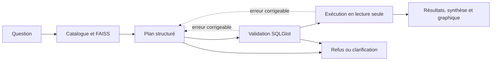

# Enterprise Agentic Analytics

AI-2 transforme une question métier en analyse SQL vérifiable. Le mode démo utilise des données fictives et fonctionne sans clé API.

## Démo

```powershell
docker compose up --build --wait -d
```

Sous Windows, utilise `scripts\docker.ps1` à la place de `docker` si Docker Desktop est absent du PATH.

- Interface Streamlit sur [localhost:8572](http://127.0.0.1:8572).
- Documentation interactive de l’API sur [localhost:8072/docs](http://127.0.0.1:8072/docs).
- Question d’exemple « Quel est le chiffre d’affaires net par région ? »
- La réponse affiche les lignes, le graphique, la requête exécutée, les références du catalogue et les étapes de vérification.

Arrêter la démo avec `docker compose stop`. Les services HTTP sont liés à la boucle locale et PostgreSQL reste sur le réseau Compose. Les comptes et mots de passe fournis par défaut sont réservés à la base de démonstration.

## Construction étape par étape

1. **Données et couche sémantique.** Le catalogue documente les tables `orders` et `customers`, leur relation, les statuts et trois métriques. Les ventes terminées seules alimentent le chiffre d’affaires net et le panier moyen. Les montants sont stockés en centimes.
2. **Récupération du contexte.** FAISS classe les documents par similarité cosinus sur des vecteurs lexicaux pondérés. Les définitions sélectionnées entraînent l’ajout de leurs tables de référence. L’index se construit localement à partir du catalogue.
3. **Planification.** Le planificateur LLM propose un appel d’outil structuré et typé par Pydantic. Il peut proposer une requête, demander une précision ou refuser. Le planificateur démo utilise un vocabulaire fini pour proposer les mêmes types de décisions sans réseau.
4. **Validation et exécution.** SQLGlot applique une liste d’expressions, fonctions et tables permises, selon le dialecte. La connexion PostgreSQL utilise un rôle dédié qui dispose de `SELECT` sur les tables du catalogue et une transaction en lecture seule. SQLite utilise un fichier en lecture seule et son autorisateur natif. Les deux moteurs bornent le travail et la restitution.
5. **Correction et restitution.** LangGraph renvoie une catégorie d’erreur au planificateur pour les erreurs corrigeables, avec deux corrections par défaut. Une violation de la politique termine la demande. La synthèse et le graphique sont calculés directement à partir des résultats. La réponse indique toute troncature.
6. **Évaluation et traçabilité.** La suite locale contrôle les résultats, les refus et les clarifications. L’adaptateur BIRD permet de comparer la requête de l’agent à la référence exécutée. LangSmith peut recevoir les étapes, durées et volumes de tokens sur activation explicite.



Le graphe s’appuie sur l’API [LangGraph StateGraph](https://docs.langchain.com/oss/python/langgraph/graph-api). Les permissions et la lecture seule correspondent aux mécanismes [GRANT de PostgreSQL](https://www.postgresql.org/docs/current/ddl-priv.html) et [SET TRANSACTION](https://www.postgresql.org/docs/current/sql-set-transaction.html).

## Configuration LLM

Copie `.env.example` vers `.env` et configure `ANALYTICS_MODE=llm`, `ANALYTICS_LLM_MODEL` et `OPENAI_API_KEY`, ou indique un `ANALYTICS_LLM_BASE_URL` compatible Chat Completions et tool calling. Pour un serveur local sur Windows avec Docker Desktop, utilise `http://host.docker.internal:<port>/v1` depuis Compose et `http://127.0.0.1:<port>/v1` hors conteneur. Lance de nouveau `docker compose up --build --wait -d`. Le fournisseur du LLM reçoit la question et le contexte du catalogue, avec la proposition SQL précédente lors d’une correction. La synthèse locale utilise les lignes SQL.

Les tarifs par million de tokens sont configurables. Le coût LLM est estimé à partir des tarifs et de l’usage communiqué par le fournisseur. Une estimation indisponible apparaît comme `null`. Le mode démo affiche un coût fournisseur de zéro. Pour LangSmith, renseigne `ANALYTICS_LANGSMITH=true` et `LANGSMITH_API_KEY`. Les traces envoyées contiennent des métriques et des codes d’étape, sans questions, SQL ni lignes de résultat. [Instrumentation LangSmith](https://docs.langchain.com/langsmith/annotate-code)

Le périmètre démo repose sur une base dédiée et des comptes de service. Un déploiement partagé demanderait une authentification, l’affectation des droits aux utilisateurs, et la définition des vues et colonnes autorisées.

## Tests et benchmarks

```powershell
python -m pip install -e '.[ui,dev]'
python -m pytest -q
python -m ruff check .
analytics-eval --output artifacts/demo.json demo
python scripts/smoke_compose.py
```

Sans Docker, `python -m uvicorn analytics_agent.api:app --port 8072` lance l’API sur une copie SQLite temporaire du jeu de démonstration. `python -m streamlit run src/analytics_agent/ui.py --server.port 8572` lance l’interface.

Pour BIRD, place les annotations SQLite Mini-Dev (`.jsonl` ou tableau JSON) dans `data/benchmarks`. Les bases peuvent être chargées depuis le [paquet Dev de BIRD](https://bird-bench.github.io/) et extraites une par une avec le script fourni. Les versions des annotations et des bases doivent correspondre au protocole que tu souhaites reproduire. [BIRD Mini-Dev](https://huggingface.co/datasets/birdsql/bird_mini_dev)

```powershell
python scripts/extract_bird.py data/benchmarks/dev.zip california_schools
analytics-eval --output artifacts/bird-references.json bird --dataset data/benchmarks/mini_dev_sqlite.jsonl --db-root data/benchmarks/dev_databases --db-id california_schools --limit 10 --reference-check
analytics-eval --output artifacts/bird-llm.json bird --dataset data/benchmarks/mini_dev_sqlite.jsonl --db-root data/benchmarks/dev_databases --db-id california_schools --limit 10
```

La deuxième commande vérifie les références seules. La troisième utilise le planificateur LLM. Les lignes sont comparées en conservant les doublons, dans l’ordre des colonnes, avec `--ordered` pour imposer aussi l’ordre des lignes. Une référence indisponible ou tronquée est comptabilisée séparément. Une prédiction tronquée est incorrecte. Cette comparaison locale fournit une mesure d’exactitude d’exécution pour le projet. Le protocole officiel BIRD et les métriques R-VES et Soft F1 sont documentés par le benchmark. [Évaluation BIRD Mini-Dev](https://github.com/bird-bench/mini_dev#evaluation)

Le moteur SQLite et le comparateur constituent une base pour une extension au sous-ensemble SQLite de Spider 2.0-Lite. Cette extension demanderait un chargeur pour ses métadonnées et ses sorties de référence. [Spider 2.0-Lite](https://spider2-sql.github.io/)

Le [rapport de validation](docs/validation.md) présente les résultats de la démo et le protocole de l’essai BIRD.
